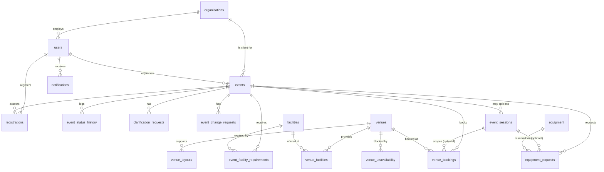

# ConnectSphere - Schema Reference

What every table holds, what the values mean, and what will trip you up.
Generated from `prisma/schema.prisma` - if the two disagree, the schema wins.

**18 tables. UUID primary keys. camelCase in code, snake_case in Postgres.**

---

## How to read this

You write `prisma.venueBooking` in code; the table in Postgres is `venue_bookings`.
Prisma translates both the model name and every field name for you, so you should
only ever see camelCase unless you are writing raw SQL or looking at Prisma Studio.

| In your code | In Postgres |
|---|---|
| `prisma.venueBooking` | table `venue_bookings` |
| `booking.requestedAt` | column `requested_at` |
| `prisma.equipment` | table `equipment` |

`req` in the tables below means the field is required - Prisma rejects a create without it.

---

## Status values

These are plain strings, not database enums, so **nothing stops you writing a typo**.
Copy from here rather than typing from memory.

| Field | Allowed values |
|---|---|
| `User.role` | `organiser` `coordinator` `venue_staff` `tech_support` `attendee` `ops_manager` |
| `Event.status` | `draft` `submitted` `under_review` `approved` `planning` `confirmed` `completed` `cancelled` `rejected` `postponed` |
| `VenueBooking.status` | `pending` `approved` `rejected` `cancelled` |
| `VenueBooking.reviewReason` | `venue_retired` `layout_removed` `layout_capacity_below_attendance` `max_capacity_below_attendance` `mandatory_facility_removed` — comma-separated, one or more |
| `EquipmentRequest.status` | `requested` `under_review` `reserved` `partially_fulfilled` `unavailable` `cancelled` |
| `Registration.status` | `registered` `waitlisted` `withdrawn` `attended` |
| `ClarificationRequest.status` | `open` `answered` `closed` |
| `EventChangeRequest.status` | `pending` `approved` `rejected` `withdrawn` |
| `Facility.category` | `facility` `accessibility` |
| `VenueUnavailability.reason` | `maintenance` `renovation` `safety` `internal_activity` `other` |
| layout names | `theatre` `classroom` `boardroom` `banquet` `exhibition` `u_shape` `cabaret` |

The Zod schemas in `src/lib/validation/` (one file per domain) enforce most of
these at the API boundary. If you add a value, add it in both places.

---

## Diagram



---

## Who owns what

| Person | Domain | Tables they mostly touch |
|---|---|---|
| Jordan | auth | `User`, `Organisation` |
| Kristen | events | `Event`, `EventSession`, `EventStatusHistory`, `ClarificationRequest`, `EventChangeRequest`, `EventFacilityRequirement` |
| Kayal | venues | `Venue`, `VenueLayout`, `Facility`, `VenueFacility`, `VenueBooking`, `VenueUnavailability` |
| Janelle | equipment | `Equipment`, `EquipmentRequest` |
| Sammi | registrations | `Registration` |
| shared | - | `Notification` - any domain may create one |

Reading another domain's tables is fine and expected. **Writing** to them is not -
if the venues route needs to change an Event, that is a conversation with Kristen first.

---

## Tables

### `Organisation`

Postgres table `organisations` &middot; `prisma.organisation`

Client companies. The access boundary for external users: an Organiser should not see events belonging to an unrelated client.

| Field | Type | | Notes |
|---|---|---|---|
| `id` | String |  | Defaults to `uuid()`. |
| `name` | String | req | Unique. The client company name. |
| `contactEmail` | String |  |  |
| `contactPhone` | String |  |  |
| `createdAt` | DateTime |  | Defaults to `now()`. |

**Relations:** `users` &rarr; User[], `events` &rarr; Event[]

### `User`

Postgres table `users` &middot; `prisma.user`

| Field | Type | | Notes |
|---|---|---|---|
| `id` | String |  | Defaults to `uuid()`. |
| `email` | String | req | Unique, used to log in. |
| `passwordHash` | String | req | bcrypt hash. Never store or return the raw password. |
| `fullName` | String | req | Routes send and receive this as `name`. Only the DB calls it fullName. |
| `phone` | String |  |  |
| `role` | String | req | One of six values - see Status values. |
| `organisationId` | String |  | NULL = internal ConnectSphere staff. Set = external user. This is the internal/external distinction. |
| `department` | String |  | Internal staff only. |
| `isActive` | Boolean |  | Deactivate leavers rather than deleting them. Defaults to `true`. |
| `createdAt` | DateTime |  | Defaults to `now()`. |

**Relations:** `organisation` &rarr; Organisation, `organisedEvents` &rarr; Event[], `coordinatedEvents` &rarr; Event[], `statusChanges` &rarr; EventStatusHistory[], `clarificationsRaised` &rarr; ClarificationRequest[], `changeRequestsRaised` &rarr; EventChangeRequest[], `changeRequestsReviewed` &rarr; EventChangeRequest[], `bookingsRequested` &rarr; VenueBooking[], `bookingsDecided` &rarr; VenueBooking[], `unavailabilityCreated` &rarr; VenueUnavailability[], `equipmentRequested` &rarr; EquipmentRequest[], `equipmentReviewed` &rarr; EquipmentRequest[], `registrations` &rarr; Registration[], `notifications` &rarr; Notification[]

**Watch out:**

- `fullName` in the DB, `name` in every API request and response. The routes translate between them.
- Roles are `organiser` / `coordinator` / `tech_support` - NOT `event_organiser` etc.

### `Venue`

Postgres table `venues` &middot; `prisma.venue`

| Field | Type | | Notes |
|---|---|---|---|
| `id` | String |  | Defaults to `uuid()`. |
| `code` | String | req | Short key staff say aloud, e.g. MAR-GH. Unique. |
| `name` | String | req |  |
| `description` | String |  |  |
| `building` | String | req | Searchable. Do not bury location in `address`. |
| `floor` | String |  |  |
| `address` | String |  |  |
| `maxCapacity` | Int | req | Absolute ceiling. The per-layout number is usually lower - use VenueLayout for suitability. |
| `opensAt` | String |  | "HH:MM" text, 24-hour. Zero-padded so string comparison works. Defaults to `"08:00"`. |
| `closesAt` | String |  | "HH:MM" text. Defaults to `"22:00"`. |
| `setupMinutes` | Int |  | Optional. Ignore unless you are handling turnaround time. Defaults to `0`. |
| `teardownMinutes` | Int |  | Optional. Defaults to `0`. |
| `isActive` | Boolean |  | Retire a venue without orphaning its past bookings. Defaults to `true`. |
| `createdAt` | DateTime |  | Defaults to `now()`. |

**Relations:** `layouts` &rarr; VenueLayout[], `facilities` &rarr; VenueFacility[], `bookings` &rarr; VenueBooking[], `unavailability` &rarr; VenueUnavailability[]

**Watch out:**

- `opensAt`/`closesAt` are strings, not DateTime. Compare them as strings.
- A booking outside opening hours is not a *clash*, but it is still not allowed - that is a separate check.
- **Narrowing the hours does not yet flag anything.** These are wall-clock text and `VenueBooking.startsAt` is a DateTime, so comparing them needs a timezone convention this codebase has not settled - the hours check itself is still unwritten. Moving `opensAt` from 08:00 to 10:00 therefore leaves an approved 09:00 booking unflagged. Deferred rather than guessed; see "Rules the database does NOT enforce" below.
- `isActive: false` is how a venue is retired. There is no delete: `VenueBooking.venueId` has no cascade, so deleting a booked venue fails at the database, and past bookings must keep pointing at the room they were held in.
- `GET /api/venues` returns active venues only unless you pass `?includeRetired=true`. A suitability or availability query should not offer a retired room.

### `VenueLayout`

Postgres table `venue_layouts` &middot; `prisma.venueLayout`

Which layouts a room supports and how many fit in each. The same room seats 500 theatre-style but 250 as a classroom, so capacity belongs here, not on Venue — this is what makes suitability checking correct.

| Field | Type | | Notes |
|---|---|---|---|
| `id` | String |  | Defaults to `uuid()`. |
| `venueId` | String | req |  |
| `layoutName` | String | req | theatre \| classroom \| boardroom \| banquet \| exhibition \| u_shape \| cabaret |
| `capacity` | Int | req | How many fit in THIS layout. The field suitability checking depends on. |

**Relations:** `venue` &rarr; Venue

**Unique:** `@@unique([venueId, layoutName])`

**Watch out:**

- Always join this for capacity questions. `Venue.maxCapacity` is the building limit, not the seating plan.

### `Facility`

Postgres table `facilities` &middot; `prisma.facility`

A named capability a room can have. One table for both search filters; `category` keeps them separate in the UI.

| Field | Type | | Notes |
|---|---|---|---|
| `id` | String |  | Defaults to `uuid()`. |
| `name` | String | req |  |
| `category` | String | req | `facility` or `accessibility` - keeps the two search filters apart. |

**Relations:** `venues` &rarr; VenueFacility[], `eventRequirements` &rarr; EventFacilityRequirement[]

### `VenueFacility`

Postgres table `venue_facilities` &middot; `prisma.venueFacility`

| Field | Type | | Notes |
|---|---|---|---|
| `venueId` | String | req | Composite primary key with facilityId. |
| `facilityId` | String | req | Join row only - no extra data. |

**Relations:** `venue` &rarr; Venue, `facility` &rarr; Facility

### `Event`

Postgres table `events` &middot; `prisma.event`

| Field | Type | | Notes |
|---|---|---|---|
| `id` | String |  | Defaults to `uuid()`. |
| `title` | String |  | Nullable so a draft can be incomplete. |
| `description` | String |  |  |
| `purpose` | String |  |  |
| `category` | String |  |  |
| `organiserId` | String | req | The external user who owns the request. |
| `organisationId` | String |  | Their client company. Set from the organiser at creation, not sent by the client. |
| `coordinatorId` | String |  | NULL until assigned. This is what separates submitted from under_review. |
| `status` | String |  | Ten values - see Status values. Defaults to `"draft"`. |
| `startsAt` | DateTime |  | The agreed schedule. Proposed changes live in EventChangeRequest, never here. |
| `endsAt` | DateTime |  |  |
| `expectedAttendance` | Int |  | Nullable for drafts. |
| `preferredLayout` | String |  | Matched against VenueLayout.layoutName. |
| `accessibilityNotes` | String |  |  |
| `specialRequirements` | String |  |  |
| `registrationEnabled` | Boolean |  | Defaults to `false`. |
| `registrationCapacity` | Int |  | Seats open to the public. NOT the same as expectedAttendance. |
| `registrationOpensAt` | DateTime |  |  |
| `registrationClosesAt` | DateTime |  |  |
| `rejectionReason` | String |  | Required when rejecting - the route enforces it. |
| `cancellationReason` | String |  |  |
| `submittedAt` | DateTime |  |  |
| `confirmedAt` | DateTime |  |  |
| `createdAt` | DateTime |  | Defaults to `now()`. |
| `updatedAt` | DateTime | req |  |

**Relations:** `organiser` &rarr; User, `organisation` &rarr; Organisation, `coordinator` &rarr; User, `facilityRequirements` &rarr; EventFacilityRequirement[], `statusHistory` &rarr; EventStatusHistory[], `clarifications` &rarr; ClarificationRequest[], `changeRequests` &rarr; EventChangeRequest[], `sessions` &rarr; EventSession[], `venueBookings` &rarr; VenueBooking[], `equipmentRequests` &rarr; EquipmentRequest[], `registrations` &rarr; Registration[], `notifications` &rarr; Notification[]

**Watch out:**

- `title`, `startsAt` and `expectedAttendance` are nullable ONLY because drafts may be incomplete. The PATCH route blocks leaving draft until they are filled.
- Never write proposed changes here. That is what EventChangeRequest is for.
- `startsAt`/`endsAt`/`expectedAttendance`/`preferredLayout` describe the event as a whole. A multi-session event's individual sessions live in `EventSession` instead. No route creates or edits sessions yet, but they are now read: see `EventSession` below.

### `EventSession`

Postgres table `event_sessions` &middot; `prisma.eventSession`

A multi-session event's individual sessions (e.g. a two-day conference where day 1 is in one room and day 2 in another). Optional: a single-session event has zero rows here, and its `VenueBooking`/`EquipmentRequest` rows link to the `Event` directly (`sessionId` NULL) exactly as before this table existed. `POST /api/events` and `PATCH /api/events/[id]` (draft edit) create and replace them, along with each session's own `EquipmentRequest` rows (`sessionId` set, reservation window = the session's times ±2h); `GET /api/events/[id]` returns them. There are no standalone session routes. A draft's sessions are replaced wholesale on each save, and a multi-session event has at least two. Venue bookings are not yet session-scoped in practice (`VenueBooking.sessionId` is still NULL until SPM-42), but `api/venues/[id]` PATCH already reads sessions: it resolves `session.expectedAttendance ?? event.expectedAttendance` when deciding whether a venue change breaks a booking, because a session-scoped booking must be judged against that session's headcount. Any other code comparing a booking against an attendance figure needs the same fallback - session data wins when present, event data is the fallback.

| Field | Type | | Notes |
|---|---|---|---|
| `id` | String |  | Defaults to `uuid()`. |
| `eventId` | String | req |  |
| `label` | String |  | Display only, e.g. "Day 1 Morning". |
| `startsAt` | DateTime | req |  |
| `endsAt` | DateTime | req |  |
| `expectedAttendance` | Int |  |  |
| `preferredLayout` | String |  | Matched against VenueLayout.layoutName. |
| `createdAt` | DateTime |  | Defaults to `now()`. |

**Relations:** `event` &rarr; Event, `venueBookings` &rarr; VenueBooking[], `equipmentRequests` &rarr; EquipmentRequest[]

### `EventFacilityRequirement`

Postgres table `event_facility_requirements` &middot; `prisma.eventFacilityRequirement`

| Field | Type | | Notes |
|---|---|---|---|
| `eventId` | String | req |  |
| `facilityId` | String | req |  |
| `isMandatory` | Boolean |  | false = nice-to-have. A missing optional facility must NOT disqualify a venue. Defaults to `true`. |

**Relations:** `event` &rarr; Event, `facility` &rarr; Facility

### `EventStatusHistory`

Postgres table `event_status_history` &middot; `prisma.eventStatusHistory`

Audit trail of status changes. Event.status holds only the current value.

| Field | Type | | Notes |
|---|---|---|---|
| `id` | String |  | Defaults to `uuid()`. |
| `eventId` | String | req |  |
| `fromStatus` | String |  | NULL on creation. |
| `toStatus` | String | req |  |
| `changedBy` | String |  |  |
| `changedAt` | DateTime |  | Defaults to `now()`. |
| `reason` | String |  | Free text - "Assigned to Priya", "Client postponed". |

**Relations:** `event` &rarr; Event, `user` &rarr; User

### `ClarificationRequest`

Postgres table `clarification_requests` &middot; `prisma.clarificationRequest`

The coordinator ↔ organiser review loop. Repeats, so each round is a row.

| Field | Type | | Notes |
|---|---|---|---|
| `id` | String |  | Defaults to `uuid()`. |
| `eventId` | String | req |  |
| `requestedBy` | String | req |  |
| `requestedAt` | DateTime |  | Defaults to `now()`. |
| `message` | String | req |  |
| `status` | String |  | open \| answered \| closed. An open one should block confirmation. Defaults to `"open"`. |
| `responseMessage` | String |  |  |
| `respondedAt` | DateTime |  |  |

**Relations:** `event` &rarr; Event, `requester` &rarr; User

### `EventChangeRequest`

Postgres table `event_change_requests` &middot; `prisma.eventChangeRequest`

Proposed changes. NOT applied to the event until approved.

| Field | Type | | Notes |
|---|---|---|---|
| `id` | String |  | Defaults to `uuid()`. |
| `eventId` | String | req |  |
| `requestedBy` | String | req |  |
| `requestedAt` | DateTime |  | Defaults to `now()`. |
| `reason` | String | req |  |
| `proposedStartsAt` | DateTime |  | NULL means 'not changing this field'. Also how the UI renders a diff. |
| `proposedEndsAt` | DateTime |  |  |
| `proposedAttendance` | Int |  |  |
| `otherChanges` | String |  |  |
| `isSignificant` | Boolean |  | true = date/time/attendance changed, so venue and equipment need re-checking. Defaults to `false`. |
| `status` | String |  | pending \| approved \| rejected \| withdrawn Defaults to `"pending"`. |
| `reviewedBy` | String |  |  |
| `reviewedAt` | DateTime |  |  |
| `reviewNotes` | String |  |  |

**Relations:** `event` &rarr; Event, `requester` &rarr; User, `reviewer` &rarr; User

### `VenueBooking`

Postgres table `venue_bookings` &middot; `prisma.venueBooking`

| Field | Type | | Notes |
|---|---|---|---|
| `id` | String |  | Defaults to `uuid()`. |
| `eventId` | String | req |  |
| `sessionId` | String |  | Set only for a multi-session event's session-specific booking. NULL means the booking applies to the whole event, as before EventSession existed. |
| `venueId` | String | req |  |
| `layoutName` | String |  | What Venue Staff physically set up. |
| `startsAt` | DateTime | req | COPIED from the event (or session) at request time. Do not read it live - changing an event must not silently move an approved booking. |
| `endsAt` | DateTime | req |  |
| `status` | String |  | pending \| approved \| rejected \| cancelled. Only `approved` blocks a venue. Defaults to `"pending"`. |
| `requestedBy` | String | req |  |
| `requestedAt` | DateTime |  | Defaults to `now()`. |
| `requirementsNote` | String |  |  |
| `decidedBy` | String |  |  |
| `decidedAt` | DateTime |  |  |
| `decisionReason` | String |  | Required when rejecting. |
| `needsReview` | Boolean |  | A venue change may have invalidated this booking. The booking is NOT changed - a human decides. Defaults to `false`. |
| `reviewReason` | String |  | Why it was flagged: comma-separated codes, see Status values. NULL when `needsReview` is false. |
| `flaggedAt` | DateTime |  | When it was last flagged. NULL when never flagged. |

**Relations:** `event` &rarr; Event, `session` &rarr; EventSession, `venue` &rarr; Venue, `requester` &rarr; User, `decider` &rarr; User

**Watch out:**

- Overlap test: `a.startsAt < b.endsAt AND a.endsAt > b.startsAt`. The same test appears in three places - write it once and reuse it.
- Only compare against `status: 'approved'`. Pending requests may legitimately compete for the same slot.
- `needsReview` is a flag, never an action. When a venue is edited or retired, `PATCH /api/venues/[id]` sets it on affected bookings and notifies the coordinator; it does not change the booking's venue, layout, times or status, and it does not touch the Event. Only `approved` bookings that have not yet finished are candidates - a pending booking is not a commitment, so there is nothing to protect by flagging it.
- **Nothing clears the flag yet.** There is no route for a coordinator to acknowledge or resolve one - that is a separate story. Do not assume a flagged booking is unresolved in real life.
- `reviewReason` accumulates. A second venue edit merges its codes into the existing list rather than replacing them, so parse it as a set.

### `VenueUnavailability`

Postgres table `venue_unavailability` &middot; `prisma.venueUnavailability`

Maintenance blocks. No event, no requester, no approval step — which is why this is separate from VenueBooking.

| Field | Type | | Notes |
|---|---|---|---|
| `id` | String |  | Defaults to `uuid()`. |
| `venueId` | String | req |  |
| `startsAt` | DateTime | req |  |
| `endsAt` | DateTime | req |  |
| `reason` | String | req | maintenance \| renovation \| safety \| internal_activity \| other |
| `notes` | String |  |  |
| `createdBy` | String | req |  |
| `createdAt` | DateTime |  | Defaults to `now()`. |

**Relations:** `venue` &rarr; Venue, `creator` &rarr; User

### `Equipment`

Postgres table `equipment` &middot; `prisma.equipment`

Tracked by quantity, not by serial number: a coordinator requests "3 projectors", never three specific units.

| Field | Type | | Notes |
|---|---|---|---|
| `id` | String |  | Defaults to `uuid()`. |
| `name` | String | req |  |
| `category` | String |  | AV \| IT \| Staging \| Networking \| Accessibility |
| `description` | String |  |  |
| `totalQuantity` | Int | req | How many ConnectSphere owns. |
| `quantityInMaintenance` | Int |  | Out of service. Available = total - maintenance - reserved. Defaults to `0`. |
| `isActive` | Boolean |  | Defaults to `true`. |

**Relations:** `requests` &rarr; EquipmentRequest[]

### `EquipmentRequest`

Postgres table `equipment_requests` &middot; `prisma.equipmentRequest`

Request and reservation in one table: a reservation only ever comes from a request, so splitting them made two rows describe one thing.

| Field | Type | | Notes |
|---|---|---|---|
| `id` | String |  | Defaults to `uuid()`. |
| `eventId` | String | req |  |
| `sessionId` | String |  | Set only for a multi-session event's session-specific request. NULL means the request applies to the whole event, as before EventSession existed. |
| `equipmentId` | String | req |  |
| `quantityRequested` | Int | req | What the coordinator asked for. |
| `quantityReserved` | Int |  | What Tech Support could commit. NULL until reviewed - use COALESCE when summing. |
| `technicalRequirements` | String |  |  |
| `startsAt` | DateTime | req | Usually wider than the event: kit leaves the store early and comes back late. |
| `endsAt` | DateTime | req |  |
| `status` | String |  | Six values. Only `reserved` and `partially_fulfilled` count against availability. Defaults to `"requested"`. |
| `requestedBy` | String | req |  |
| `requestedAt` | DateTime |  | Defaults to `now()`. |
| `reviewedBy` | String |  |  |
| `reviewedAt` | DateTime |  |  |
| `staffNotes` | String |  |  |

**Relations:** `event` &rarr; Event, `session` &rarr; EventSession, `equipment` &rarr; Equipment, `requester` &rarr; User, `reviewer` &rarr; User

**Unique:** `@@unique([eventId, equipmentId])`

**Watch out:**

- `quantityReserved` is NULL before review - use `COALESCE(SUM(...), 0)` or your total comes back null.
- One row per equipment type per event (`@@unique`). Asking for more means editing the quantity, not adding a row.
- The unique constraint is `(eventId, equipmentId)`, NOT `(eventId, sessionId, equipmentId)` - deliberately, because Postgres treats NULL as distinct in a unique index and a three-column version would stop deduplicating on single-session events (`sessionId` NULL), which is the common case. The tradeoff: two sessions of the SAME multi-session event can't yet each independently request the same equipment type. Needs a partial/expression index to fix properly - known limitation, not yet hit by any route since none write `sessionId` yet.

### `Registration`

Postgres table `registrations` &middot; `prisma.registration`

| Field | Type | | Notes |
|---|---|---|---|
| `id` | String |  | Defaults to `uuid()`. |
| `eventId` | String | req |  |
| `attendeeId` | String | req |  |
| `status` | String |  | registered \| waitlisted \| withdrawn \| attended Defaults to `"registered"`. |
| `registeredAt` | DateTime |  | Defaults to `now()`. |
| `withdrawnAt` | DateTime |  |  |
| `dietaryRequirements` | String |  | The attendee's own needs, not the event's. |
| `accessibilityRequirements` | String |  |  |

**Relations:** `event` &rarr; Event, `attendee` &rarr; User

**Unique:** `@@unique([eventId, attendeeId])`

**Watch out:**

- `@@unique([eventId, attendeeId])` means a withdrawn attendee cannot simply INSERT again - the route reactivates their existing row instead.
- Count `registered` + `attended` for seats taken. `withdrawn` frees the place.

### `Notification`

Postgres table `notifications` &middot; `prisma.notification`

| Field | Type | | Notes |
|---|---|---|---|
| `id` | String |  | Defaults to `uuid()`. |
| `recipientId` | String | req | One row per person, not per event. |
| `type` | String | req | Free string, no constraint. Written so far: `booking_needs_review`, `booking_venue_retired`. |
| `title` | String | req |  |
| `body` | String | req |  |
| `eventId` | String |  | Lets the notification deep-link to what caused it. |
| `isRead` | Boolean |  | Defaults to `false`. |
| `createdAt` | DateTime |  | Defaults to `now()`. |

**Relations:** `recipient` &rarr; User, `event` &rarr; Event

**Watch out:**

- This table is now actually written to. Use the helpers in `src/lib/notifications.ts` rather than `tx.notification.create` directly: `notifyUser(tx, recipientId, {...})` for one named person, `notifyRole(tx, role, {...})` for a queue. Both take a transaction, so a notification is only ever created alongside the state change that caused it.
- `recipientId` for a venue review flag is `event.coordinatorId` **falling back to `booking.requestedBy`**. `coordinatorId` is nullable, so an unassigned event has no assigned Coordinator to notify; the requester is the person who asked for the room and in practice the coordinator who has to find another one.
- There is no `venueId` or `bookingId` column, only `eventId`. A notification about a venue or a booking has to name the room and the dates in `body`, or the recipient cannot tell which booking it means.
- **Nothing reads these yet.** The top-bar bell and every sidebar "Notifications" link point at a screen that does not exist, so a written notification is currently invisible in the app.

---

## Rules the database does NOT enforce

There are no CHECK constraints and no triggers. Postgres will happily store a
double-booked venue. These rules live in route code:

| Rule | Where it lives | What it checks |
|---|---|---|
| Draft completeness | `api/events/[id]` PATCH | title, category, startsAt, endsAt, expectedAttendance filled before leaving `draft` |
| Rejection reason | `api/events/[id]` PATCH | a reason is given when status becomes `rejected` |
| Venue suitability | venues domain (to write) | layout capacity >= attendance, all mandatory facilities present |
| Booking conflict | venues domain (to write) | no overlapping `approved` booking or unavailability |
| Venue change impact | `src/lib/venueImpact.ts`, applied by `api/venues/[id]` PATCH | which future `approved` bookings a venue edit or retirement newly breaks, so they can be flagged. Pure functions, unit tested without a database. Does NOT yet cover narrowed `opensAt`/`closesAt` - that needs a timezone convention the codebase has not settled |
| Equipment availability | equipment domain (to write) | requested <= total - maintenance - overlapping reservations |
| Registration | `api/registrations` POST | event confirmed, within window, not already registered, seats left |

Wrap check-and-write in `prisma.$transaction(...)`. Two people clicking at the
same moment will both pass a check that is not inside one.

The overlap test, which you need in three of these:

```ts
// two periods overlap if each starts before the other ends
startsAt: { lt: otherEnd },
endsAt:   { gt: otherStart },
```

---

## Queries you will write over and over

**Venues that fit an event and are free:**

```ts
const venues = await prisma.venue.findMany({
  where: {
    isActive: true,
    layouts: { some: { layoutName: event.preferredLayout, capacity: { gte: event.expectedAttendance } } },
    bookings: { none: { status: 'approved', startsAt: { lt: event.endsAt }, endsAt: { gt: event.startsAt } } },
    unavailability: { none: { startsAt: { lt: event.endsAt }, endsAt: { gt: event.startsAt } } },
  },
  include: { layouts: true, facilities: { include: { facility: true } } },
});
```

**Seats left on an event:**

```ts
const taken = await prisma.registration.count({
  where: { eventId, status: { in: ['registered', 'attended'] } },
});
```

**Equipment free in a window:**

```ts
const eq = await prisma.equipment.findUnique({ where: { id } });
const agg = await prisma.equipmentRequest.aggregate({
  _sum: { quantityReserved: true },
  where: { equipmentId: id, status: { in: ['reserved', 'partially_fulfilled'] },
           startsAt: { lt: endsAt }, endsAt: { gt: startsAt } },
});
const available = eq.totalQuantity - eq.quantityInMaintenance - (agg._sum.quantityReserved ?? 0);
```

**Bookings flagged for review, newest first** (uses the `[needsReview, flaggedAt]` index):

```ts
const forReview = await prisma.venueBooking.findMany({
  where: {
    needsReview: true,
    // Scope to one coordinator's own work by going through the event.
    event: { coordinatorId },
  },
  orderBy: { flaggedAt: 'desc' },
  include: {
    venue: { select: { code: true, name: true } },
    event: { select: { title: true, expectedAttendance: true } },
  },
});
// reviewReason holds comma-separated codes - parse it as a set, it accumulates.
const reasons = forReview[0]?.reviewReason?.split(',') ?? [];
```

---

## Demo data

`npx prisma db seed` loads a full working dataset. It **wipes every table first**,
so do not run it when you have data you care about.

| | |
|---|---|
| Organisations | 12 |
| Users | 71 (15 staff, 16 organisers, 40 attendees) |
| Venues | 16 across 5 buildings, with layouts and facilities |
| Equipment | 26 types, some units in maintenance |
| Events | 23, covering every status |
| Bookings | 19 - approved, pending, rejected and cancelled |
| Registrations | ~230 |

**Every account's password is `password123`.**

Useful logins:

- `daniel.tan@connectsphere.com` - coordinator with several events
- `grace.lim@connectsphere.com` - ops manager, sees the unassigned queue
- `marcus.wong@connectsphere.com` - venue staff
- `kenji.sato@connectsphere.com` - tech support
- organiser emails are generated from the company name; check `users` in Prisma Studio

The data deliberately contains things to find: venues that lack a hearing loop so
suitability checks can rule them out, equipment in maintenance so availability is
not just the total, an event rejected with a reason on record, a change request
refused because the room caps at 40, and one approved future booking that starts
out flagged for review because its room was made too small for it.

**Watch out:**

- **Every id is a fresh UUID on every reseed.** `prisma/seed.ts` hardcodes no ids at all - each `create()` omits `id` and lets `@default(uuid())` fire, then keeps the generated values in in-memory maps (`venues[code]`, `users[email]`, `events[key]`) only long enough to wire up that one run's relations. So reseeding does not merely reset the data, it renumbers it: the "same" logical venue comes back with a different id. Any saved URL (`/venues/<uuid>/edit`), any id pasted into a ticket or a screenshot, and any id hardcoded in a fixture is dead after a reseed.
- **The only things stable across a reseed are each model's natural unique key**: `Venue.code`, `User.email`, and `name` on `Organisation`, `Facility` and `Equipment`. Look records up by those, never by id, if the code has to survive a reseed - the seed script's own labels (`"JUR-TRN"`, `"confirmed_claims"`) are not in the database.
- **`Event` has no unique identifier at all.** Not `title`, which is nullable *and* non-unique, and the seed's `key` (`"confirmed_claims"`) is never persisted. So there is currently **no reliable way to refer to "the same event" across a reseed or between environments** - an event can only be re-found by matching on title by convention. That is a schema gap, not just a seed-script quirk: anything that needs a durable external reference to an event (a test fixture, a ticket, a report, an integration) has nothing to hold on to.

